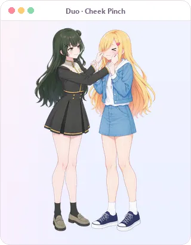

 

[简体中文](./README.md) &nbsp;|&nbsp; **English**

  
  
  
  

A local Windows desktop pet app focused on **duo interactions** and **responsive 60Hz dragging**. 
Portable, no installer or login required, and all fanwork character packs are free.

---

## Previews

<table>
  <tr>
    <td align="center" width="33%">
      
       
      <strong>Cheek Pinch</strong>
       
      Triggered when dragging two pets close
    </td>
    <td align="center" width="33%">
      
       
      <strong>Face Push</strong>
       
      With turn-in & settle transitions
    </td>
    <td align="center" width="33%">
      
       
      <strong>Fried Egg Form</strong>
       
      Click 6 times quickly to trigger
    </td>
  </tr>
</table>

---

## Features

- **Duo Interactions**: Drag two pets near each other to trigger pair animations (5 scenes included: cheek pinch, face push, hair tidy, hood grab, and whisper).
- **60Hz Fluid Drag**: Real-time directional sway, quick turns, and drop-settle animations in all directions—not a static PNG being dragged around.
- **Idle Routines**: Standing, sitting, crossed legs, napping, walking around the screen, peeking from edges, and character-specific idle habits so they don't just stare at your cursor.
- **Built-in Standard / Lite Mode Toggle**: Switch anytime in **Console → Settings → Run Mode**—Lite mode keeps native sharpness while using static drag to save VRAM/RAM, pausing when covered/fullscreen, releasing idle helper windows, and slowing down auto-duo frequency.
- **Local & Modular Packs**: No installer, no account, and no cloud AI required. New characters and pair scenes can be imported via `.petpack` (solo) and `.duopack` (duo) files without redownloading the whole app.

---

## Characters

| Character / Pair | Included | Status | Notes |
| :--- | :--- | :---: | :--- |
| **Viola × Arale Nakamachi** *BanG Dream! YUME∞MITA* | Both solo pets (full drag) + 5 duo interactions (pinch / face push / hair tidy / hood grab / whisper) + fried-egg easter egg |  | [Releases](../../releases) / Mirrors |
| **MyGO!!!!!** (Anon Chihaya / Raana Kaname, etc.) | Multi-pose solo + full drag + duo interaction packs |  | Coming to Releases after testing |

---

## Download & Links

- **Download**: Grab the `win64.zip` build from **[Releases](../../releases)** (single full-quality package with a built-in Standard / Lite mode toggle).
- **QQ Group**: `1137271893` *(mirrors, early character builds, bug reports & character requests)*

> For OC / VTuber desktop pet inquiries, feel free to DM the admin in the group.

---

## Run Modes & System Requirements

Switch anytime in **Console → Settings → Run Mode**. **Both modes keep native sharpness:**

| Aspect | Standard Mode (Default) | Lite Mode (Work / Integrated GPU / Low Resource) |
| :--- | :--- | :--- |
| **Visual sharpness** | Native resolution | **Same native resolution** |
| **Dragging** | Full 60Hz directional carry (BC7 texture pool) | Static window drag (skips BC7 drag pool to save VRAM & RAM) |
| **Duo cadence** | Normal auto-duo cooldown | Calmer auto-duo (3× longer cooldown); manual clicks & pats respond normally |
| **Background power** | Always ready | Auto-destroys idle helper windows; **auto-pauses when covered / in fullscreen games** |

### System Requirements

- **OS**: Windows 10 / 11 (64-bit). macOS, Linux, and 32-bit Windows are not supported yet.
- **GPU**: All animations are pre-rendered—**no internet connection, AI model, or high-end GPU required**. Any modern Intel/AMD integrated GPU or dedicated GPU supporting WebGL2 and BC7 textures works (switch to Lite Mode on laptops/iGPUs or while gaming).
- **RAM & Storage**: `8 GB+` RAM (`16 GB` + dedicated GPU recommended for Standard Mode with two pets), `~4 GB` free disk space.

---

## Usage & FAQ

<strong>1. How to run</strong>

 

1. Download `win64.zip` and **extract the whole folder first** (do not launch the `.exe` directly from inside WinRAR / 7-Zip, and avoid protected folders like `C:\Program Files`).
2. Open the extracted folder and double-click `PitaPet.exe` (keep `resources` and companion files in the same directory).
3. **Controls**:
   - Drag pets anywhere; move two pets close to trigger 5 duo interactions (subject to cooldown).
   - Click a pet 6 times rapidly for the easter egg. Use the system tray icon to open the Console (toggle Standard/Lite mode, switch pets, resize, adjust dialogue frequency, import packs, or quit).

<strong>2. Importing new <code>.petpack</code> / <code>.duopack</code> files</strong>

 

Open the tray **Console → Import** and pick your `.petpack` or `.duopack` file. Then add the character from the roster—importing won't overwrite your current setup.

<strong>3. Windows SmartScreen ("Windows protected your PC")</strong>

 

This is an unsigned indie build, so SmartScreen will warn on first launch. Click **More info → Run anyway**. All animations and core features run locally; optional anonymous usage stats (active days and interaction counts only, no personal data) can be toggled off anytime in **Console → Settings**.

---

## Copyright & Anti-Resale

1. All *BanG Dream!* character packs here are unofficial, non-profit fanworks. Character copyrights belong to Bushiroad Inc. / BanG Dream! Project. These packs are **free forever** for personal desktop use only.
2. **Resale is strictly prohibited** (on any storefront, paid cloud link, or paid group). Do not unpack `.webm` / `.bc7z` assets for redistribution or AI training. If you paid for this, ask for a refund and report the seller.

Full terms in [LICENSE](./LICENSE).
