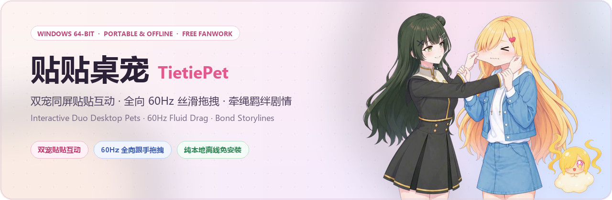

 

[简体中文](./README.md) &nbsp;|&nbsp; **English**

 

An interactive duo desktop pet app for Windows. Extract and run — all fanwork character packs are free.

---

## Previews

<table>
  <tr>
    <td align="center" width="33%">
      
       
      <strong>Cheek Pinch</strong>
    </td>
    <td align="center" width="33%">
      
       
      <strong>Face Push</strong>
    </td>
    <td align="center" width="33%">
      
       
      <strong>Click 6× for Fried Egg</strong>
    </td>
  </tr>
</table>

---

## Download (Windows 64-bit)

Current pack: **v0.5.1 Viola × Arale Nakamachi** (5 duo interactions: cheek pinch, face push, hair tidy, hood grab, whisper + fried-egg easter egg). **MyGO!!!!!** packs are up next.

- **GitHub Releases**: Download `win64.zip` from **[Releases](../../releases)**
- **China Mobile Cloud (Fast Mirror)**: https://yun.139.com/shareweb/#/w/i/2yA8MyNmmpPg0
- **Quark Drive**: https://pan.quark.cn/s/f8345a4c49d5?pwd=M67i (Code: `M67i`)
- **QQ Group**: `1137271893` (bug reports, early packs, OC / VTuber custom inquiries)

---

## Quick Start

1. **Run**: Extract the whole zip into a normal folder (don't launch from inside WinRAR/7-Zip or `C:\Program Files`), then double-click **`PitaPet.exe`**.
2. **Controls**: Drag pets around; move two pets close to trigger duo animations. Click 6 times fast for the easter egg. Open the **Console** from the system tray icon to resize, switch modes, import `.petpack` / `.duopack`, or quit.
3. **Laptops & Lite Mode**: Works on Windows 10 / 11 (64-bit) without needing a high-end GPU. On laptops or while gaming, switch to **Lite Mode** in **Console → Settings** — keeps full sharpness, uses much less memory, and pauses automatically in fullscreen apps.
4. **SmartScreen**: Unsigned indie build — click **More info → Run anyway** on first launch. Anonymous usage stats can be toggled off anytime in Settings.

---

## Copyright & Anti-Resale

- All *BanG Dream!* packs are non-profit fanworks (character copyrights belong to Bushiroad Inc. / BanG Dream! Project), **free forever** for personal use.
- **No resale** and no unpacking assets for redistribution or AI training. See [LICENSE](./LICENSE) for full terms.
