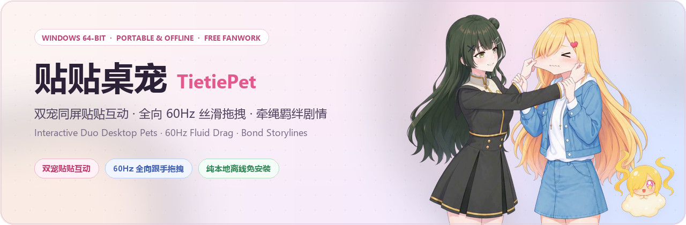
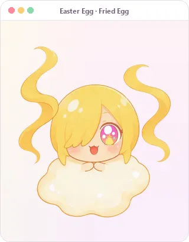

 

**简体中文** &nbsp;|&nbsp; [English](./README.en.md)

  
  
  
  

一个跑在 Windows 上的离线桌面宠物程序，重点做了**双人互动**和**更跟手的拖拽**。 
绿色免安装，解压就能跑，所有同人角色包免费分享。

---

## 实机预览

<table>
  <tr>
    <td align="center" width="33%">
      
       
      <strong>双人捏脸</strong>
       
      把两只拖近后触发
    </td>
    <td align="center" width="33%">
      
       
      <strong>双人推脸</strong>
       
      自带转向和回落衔接
    </td>
    <td align="center" width="33%">
      
       
      <strong>煎蛋彩蛋</strong>
       
      连续快点 6 次触发
    </td>
  </tr>
</table>

---

## 主要功能

- **双人贴贴互动**：把两只桌宠拖近会触发专属双人动作（捏脸、推脸等）。右键点两只之间的连线，可以打开关系小剧情和对话选项。
- **60Hz 全向跟手拖拽**：上、下、左、右拖拽和急转都有对应的实时摆动和松手回落，不是静态立绘硬拖。
- **日常待机动作**：包含站姿、坐姿、翘腿、趴卧打盹、桌面散步、屏幕边缘探头，以及角色各自的小动作，不会一直死盯着屏幕。
- **纯本地离线 & 分包导入**：不联网、不用安装。后续出新角色可以直接通过 `.petpack`（单人包）和 `.duopack`（双人互动包）导入，不用重下整个客户端。

---

## 角色进度

| 角色 / 组合 | 内容 | 状态 | 说明 |
| :--- | :--- | :---: | :--- |
| **薇欧拉 × 仲町阿拉蕾**（薇蕾） *BanG Dream! YUME∞MITA* | 双人单宠（含完整拖拽）+ 捏脸/推脸双人包 + 关系剧情 + 煎蛋彩蛋 |  | [Releases](../../releases) / 群内网盘分流 |
| **MyGO!!!!!**（千早爱音 / 要乐奈 等） | 单人多姿态 + 全向拖拽 + 双人互动包 |  | 做好后会先发群里，再同步到 Releases |

---

## 下载与交流

- **直接下载**：去右侧 **[Releases](../../releases)** 下载最新的 `win64.zip`。
- **QQ 交流群**：`待填写群号`（GitHub 下载慢可以进群拿网盘分流，新角色、新 `.duopack` 也会优先发群里，有 Bug 或想看的角色可以直接群里说）
- **Bilibili 主页**：`待填写主页链接`

> 原创形象（OC）或 VUP 如有专属桌宠合作意向，进群私聊群主即可。

---

## 使用说明与常见问题

<strong>1. 怎么打开？（绿色包）</strong>

 

1. 下完 `win64.zip` 后，**先完整解压到一个文件夹里**（别在压缩软件预览窗口里直接双击 `.exe`，不然读不到资源文件）。
2. 双击文件夹里的 `.exe` 启动（同目录的 `resources` 等文件别删）。
3. **基本操作**：
   - 按住角色随便拖；把两只拖近可触发双人互动（有冷却时间）。
   - 右键点两只之间的连线打开关系面板。
   - 连点角色 6 次触发变身彩蛋；右下角系统托盘图标可打开控制台（换角色、调大小/话痨度、导包、退出）。

<strong>2. 怎么导入新的 <code>.petpack</code> / <code>.duopack</code>？</strong>

 

打开右下角托盘「控制台」→「导入」，选中 `.petpack` 或 `.duopack` 文件即可。导完后在角色列表里手动添加到桌面，不会覆盖你原来的设置。

<strong>3. Windows 弹蓝框提示“已保护你的电脑”怎么办？</strong>

 

个人免费发的包没买商业签名证书，Windows SmartScreen 第一次见到新版本 `.exe` 都会弹这个。点 **更多信息 → 仍要运行** 就行。程序纯离线，没有联网功能。

---

## 版权与防倒卖说明

1. 本仓库发布的《BanG Dream!》相关角色桌宠均为个人非营利同人二创，角色版权归原著作权方（Bushiroad Inc. / BanG Dream! Project 等）所有，**永久免费分享**，仅限个人桌面自用。
2. **禁止任何形式的倒卖**（闲鱼、淘宝、拼多多、付费网盘、付费群等），也禁止解包提取内部 `.webm` / `.bc7z` 素材二次分发或拿去炼丹。如果你是花钱买的，请直接退货并举报卖家。

完整协议见根目录 [LICENSE](./LICENSE)。
